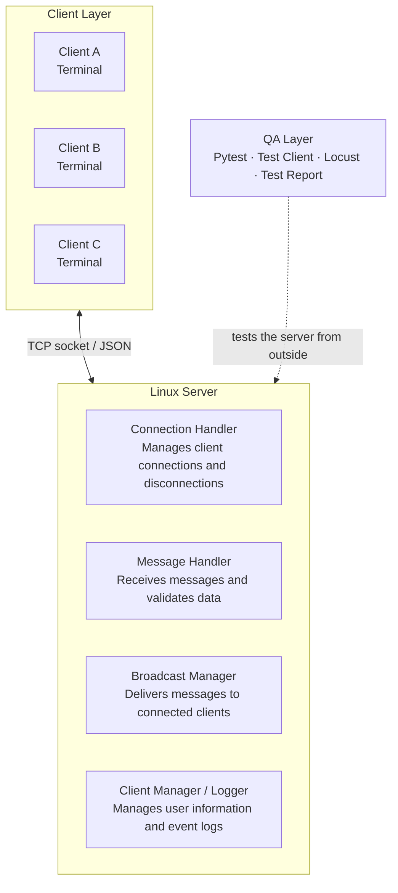

# System Architecture Design

Nov 21, 2026 · @Hyungjoon Jin

The system follows a Client-Server architecture: the server runs on Linux, and clients run from a Mac terminal or any other computer's terminal.

## 1. System structure

Terminal clients connect to a single Linux server over TCP and exchange JSON messages. The QA layer (Pytest, a test client, Locust, test reports) is not a module inside the server; it is a separate test environment that verifies the server from the outside.

&#91;embedded content: system architecture · 3 layers\]

Clients talk to the server only through the TCP/JSON connection; the QA layer sits outside the server.

The same diagram as Mermaid code, so it renders on GitHub when this document is saved as `docs/architecture.md`:



| Server component | Responsibility |
| --- | --- |
| Connection Handler | Manages client connections and disconnections |
| Message Handler | Receives messages and validates data |
| Broadcast Manager | Delivers messages to connected clients |
| Client Manager / Logger | Manages user information and event logs |

## 2. Communication protocol

TCP delivers data as a continuous byte stream, not as discrete messages, so sending bare JSON leaves message boundaries ambiguous. This project uses a 4-byte length header followed by the JSON data.

For example, suppose the following message is sent:

```json
{
  "type": "message",
  "sender": "client_a",
  "content": "Hello everyone"
}
```

The transmission structure is:

```text
[4 Bytes: Payload Length]
[JSON Payload]
```

With this framing, the receiver can separate messages correctly even when one message arrives in several pieces or several messages arrive at once.

The initial message types are:

| Type | Description |
| --- | --- |
| JOIN | A client connects |
| MESSAGE | A regular chat message |
| LEAVE | A client exits |

Types such as ERROR and USER\_LIST can be added later.

## 3. Python project folder structure

The GitHub repository is organized as follows.

```text
multi-client-chat/
│
├── server/
│   ├── __init__.py
│   ├── main.py
│   ├── connection.py
│   ├── message_handler.py
│   ├── client_manager.py
│   └── logger.py
│
├── client/
│   ├── __init__.py
│   ├── main.py
│   └── receiver.py
│
├── common/
│   ├── __init__.py
│   └── protocol.py
│
├── tests/
│   ├── unit/
│   ├── integration/
│   └── performance/
│
├── docs/
│   ├── SRS.md
│   ├── architecture.md
│   ├── test_plan.md
│   └── test_report.md
│
├── logs/
│
├── requirements.txt
├── pytest.ini
├── .gitignore
└── README.md
```

Each folder has the following role:

- `server/`: the server program that runs on Linux
- `client/`: the client that runs in the user's terminal
- `common/`: the communication specification shared by server and client
- `tests/`: automated QA tests
- `docs/`: project documents
- `logs/`: server run logs

Not every file is needed from the start; add the required files one at a time as sprints progress.

## 4. Git branch strategy

Development and QA work are kept separate but managed in the same repository.

```text
main
  │
  └── develop
       │
       ├── feature/CHAT-101-server
       ├── feature/CHAT-102-client
       ├── feature/CHAT-103-message
       │
       ├── test/CHAT-201-unit
       └── test/CHAT-202-integration
```

The principles are:

- `main`: the stable, final version
- `develop`: the integration branch for development
- `feature/*`: feature development
- `test/*`: test code development

Include the Jira issue ID in every branch name and commit message.

